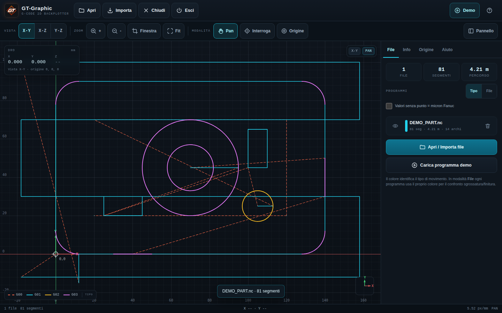
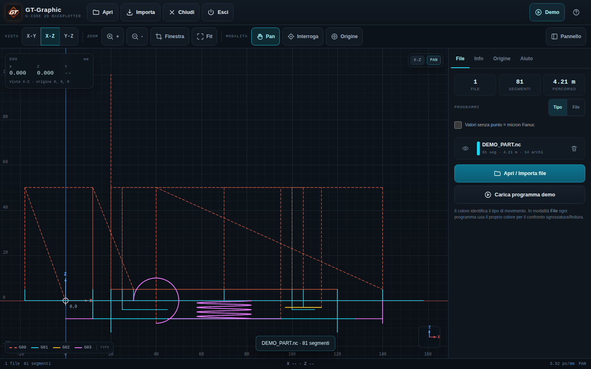
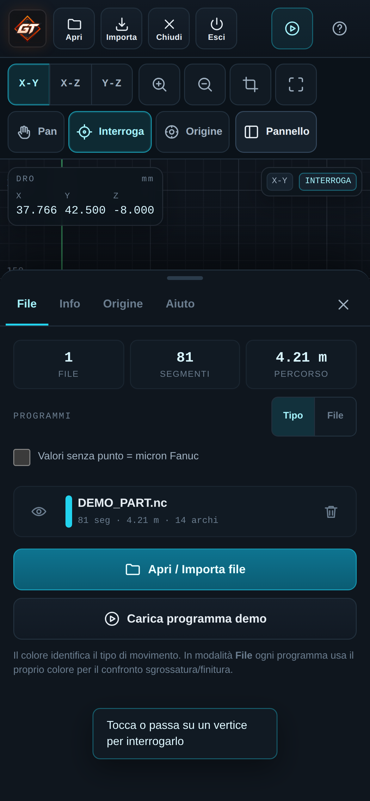
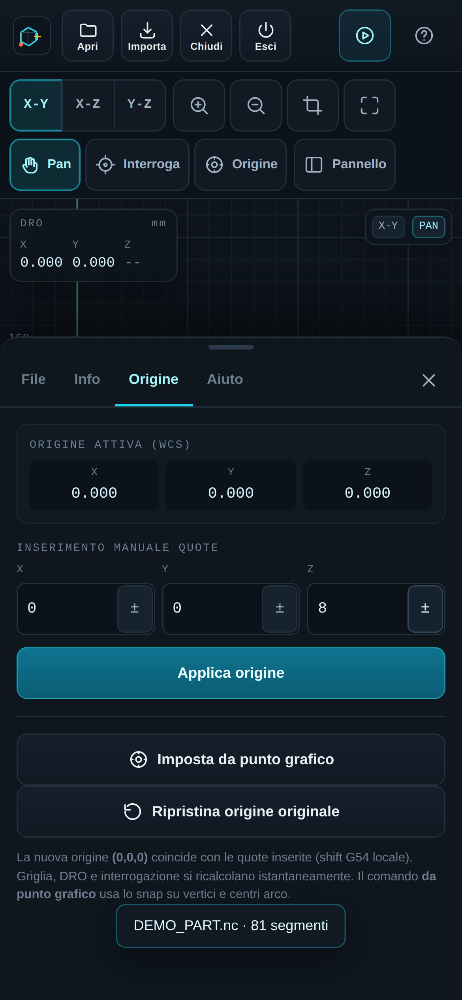
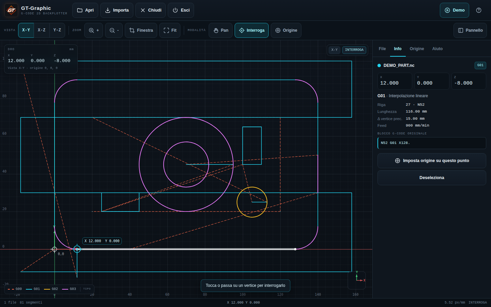
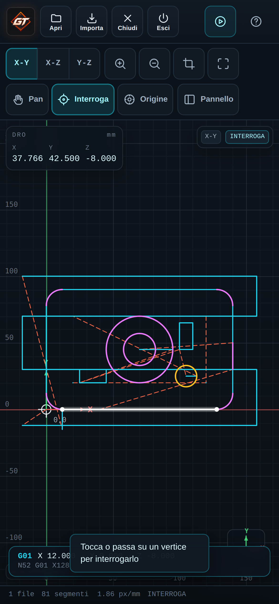

<p align="center"></p>

# GT-Graphic

**Visualizzatore 2D e analizzatore geometrico di programmi G-Code ISO/Fanuc** per desktop e iPhone. Web app statica, senza dipendenze runtime, con proiezione ortogonale tecnica su tre piani, interrogazione dei punti con snap, gestione dell'origine pezzo e funzionamento offline come PWA.

- **Demo online:** <https://lucata76-beep.github.io/GT-Graphic/>
- **Repository:** <https://github.com/lucata76-beep/GT-Graphic>
- **Versione:** 1.1.0



---

## Caratteristiche

| Area | Funzioni |
|---|---|
| **File** | `Apri`, `Importa file` multipli sovrapposti, `Chiudi`, `Esci` con riavvio rapido. Lettura di `.nc`, `.txt`, `.tap`, `.iso` e file **senza estensione** (`SG1-1`, `FT1-2`, `O0001`). Drag & drop su desktop. |
| **Viste 2D** | `X-Y` (pianta), `X-Z` (frontale), `Y-Z` (laterale). Proiezione ortogonale pura, nessuna vista 3D, nessun WebGL. |
| **Navigazione** | `Zoom +`, `Zoom -`, `Zoom Finestra` con rettangolo elastico, `Fit`, pan con mouse o dito, pinch-to-zoom a due dita, rotellina centrata sul puntatore. |
| **Interroga punti** | Snap magnetico su vertici, estremi e centri arco entro una tolleranza in pixel (16 px mouse, 26 px touch). HUD con coordinate X/Y/Z, tipo movimento, numero di riga, blocco originale, lunghezza e distanza dal vertice precedente. |
| **Origine pezzo** | Simbolo `(0,0,0)` sempre visibile, DRO live, tre assi del piano attivo, `Imposta da punto grafico`, inserimento manuale X/Y/Z con pulsanti `±`, `Ripristina origine originale`. Griglia, DRO e interrogazione si ricalcolano rispetto all'origine attiva. |
| **Multi-programma** | Elenco file con colore dedicato, toggle mostra/nascondi, rimozione, confronto sgrossatura/finitura con colorazione per file o per tipo di movimento. |
| **PWA / iOS** | `manifest.json`, service worker con cache offline, icone 192/512/maskable, `apple-touch-icon`, `100dvh`, `safe-area-inset`, `touch-action: none` sul canvas, pulsanti con area di tocco minima 44×44 px. |

### Interfaccia

Palette industriale ad alto contrasto: sfondo `#0d1117`, griglia a basso affaticamento, **G00** tratteggiato ambra/rosso, **G01** ciano continuo, **G02/G03** giallo e magenta. Pannelli flottanti semitrasparenti con `backdrop-filter: blur(8px)`, toolbar compatta a due righe su iPhone, legenda colori sempre leggibile.

| Desktop, vista X-Z | iPhone, pannello a scomparsa |
|---|---|
|  |  |

---

## Avvio rapido

### Online

Aprire <https://lucata76-beep.github.io/GT-Graphic/> da qualsiasi browser. Su iPhone, con Safari: **Condividi → Aggiungi alla schermata Home** per avere l'app a schermo intero e offline.

### In locale

L'app non richiede build né server applicativo. È sufficiente aprire `index.html` con un doppio clic: tutti gli script sono classici e il programma demo è incorporato, quindi funziona anche da `file://`.

Per il service worker e l'installazione PWA serve invece un'origine HTTP:

```bash
cd GT-Graphic
python3 -m http.server 8000
# aprire http://localhost:8000/
```

### Su iPhone

1. Aprire la URL di GitHub Pages in Safari.
2. Toccare **Condividi** e scegliere **Aggiungi alla schermata Home**.
3. Aprire l'app dall'icona GT-Graphic.
4. Toccare **Carica programma demo** oppure **Apri** e selezionare un file dall'app **File** (anche senza estensione).

Il selettore file non usa filtri `accept`, quindi iOS mostra tutti i documenti disponibili, compresi i programmi senza estensione tipici dei controlli CNC.

---

## Comandi e gesti

| Azione | Desktop | iPhone |
|---|---|---|
| Pan | Tasto centrale/destro trascinato, oppure sinistro in modalità **Pan** | Un dito in modalità **Pan** |
| Zoom | Rotellina, `Zoom +` / `Zoom -` | Pinch a due dita, pulsanti |
| Zoom finestra | Trascinare un rettangolo in modalità **Finestra** | Un dito, stesso flusso |
| Interroga | Clic su vertice/centro con **Interroga** attivo | Tap sul vertice |
| Imposta origine | Clic su vertice con **Origine → Da punto grafico** | Tap sul vertice |
| Adatta a schermo | `Fit` o `F` | Pulsante `Fit` (icona) |
| Cambio vista | `1` X-Y, `2` X-Z, `3` Y-Z | Pulsanti vista |
| Annulla modalità | `Esc` | Pulsante **Pan** |

Altre scorciatoie desktop: `+`/`-` zoom, `P` pan, `I` interroga, `Z` zoom finestra, `O` pannello origine, frecce per traslare, `Ctrl/Cmd+O` per aprire un file.

---

## Formati e parser

Il parser è in `assets/js/parser.js`, non usa dipendenze e produce segmenti con geometria, numero di riga e blocco originale. Le statistiche includono lunghezza totale, lunghezza di taglio, rapidi, numero di archi e stima del tempo (senza accelerazioni/decelerazioni).

| Codice | Gestione |
|---|---|
| `G00` | Posizionamento rapido, linea tratteggiata |
| `G01` | Interpolazione lineare |
| `G02` / `G03` | Arco orario / antiorario con `I`, `J`, `K` oppure `R` (anche `R` negativo per archi > 180°) |
| `G17` / `G18` / `G19` | Piani X-Y, Z-X, Y-Z |
| `G90` / `G91` | Quote assolute / incrementali |
| `G20` / `G21` | Pollici / millimetri, conversione immediata in mm |
| `G54`–`G59` | Ignorate come offset: l'app usa l'origine impostata dall'utente |
| `M`, `S`, `T`, `F`, `G40`–`G43` | Non geometrici: conservati nel blocco, non tracciati |
| `G28`, `G30`, `G53`, `G92`, `G68` | Non tracciati; avviso in elenco |
| `G73`, `G74`, `G76`, `G81`–`G89` | Cicli fissi non supportati geometricamente; avviso in elenco |

Sono gestiti commenti `(...)`, commenti di riga `;`, delimitatore `%`, numeri di blocco `N`, più codici G nello stesso blocco e archi elicoidali con variazione dell'asse normale al piano. Un arco a 360° con punto di arrivo coincidente alla partenza viene tracciato come cerchio completo.

### Convenzione dei piani

La proiezione rispetta la convenzione Fanuc: in `G17` la normale è `+Z`, in `G18` è `+Y`, in `G19` è `+X`. Di conseguenza, nella vista `X-Z` (X a destra, Z in alto) un `G02` appare antiorario: non è un errore di rendering, è la vista dal lato `+Y`.

### File senza estensione

Il contenuto viene letto con `FileReader.readAsText()` e interpretato come testo ISO. Non è richiesta alcuna estensione: il nome `SG1-1` o `FT1-2` viene mostrato nella lista e associato ai segmenti.

---

## Origine e DRO

L'origine attiva è uno shift locale `(X, Y, Z)` applicato a griglia, DRO, coordinate dell'inspector e quote del punto selezionato. Non modifica la geometria memorizzata: i segmenti restano nelle coordinate del programma, la trasformazione avviene solo in visualizzazione e interrogazione.

- **Da punto grafico:** attiva la modalità, tocca un vertice o un centro arco; il punto diventa `(0,0,0)`.
- **Manuale:** inserisci X/Y/Z e premi **Applica origine**. I pulsanti `±` accanto ai campi permettono di cambiare segno senza dover digitare il meno, comodo sulla tastiera numerica di iOS.
- **Ripristina:** riporta l'origine a `(0,0,0)`.



---

## Programmi di esempio

| File | Contenuto |
|---|---|
| `samples/DEMO_PART.nc` | Piastra 140×90×12: spianatura, contorno con raccordi `G03`, tasca circolare elicoidale `G03`, tasca `G02`, cave, archi `G18`/`G19`, fori con `G91`. 81 segmenti. |
| `samples/SG1-1` | Staffa senza estensione: contorno `G02`, tasca con `G03`, archi `G18`/`G19`, fori in incrementale. 53 segmenti. |
| `samples/FT1-2` | Programma in pollici `G20`: contorno 4,5×3,5 in, tasca circolare, arco `G18`. 21 segmenti. |

Il pulsante **Carica programma demo** usa una copia incorporata generata da `samples/DEMO_PART.nc` tramite `node tools/build-demo.js`: la demo funziona anche offline e da `file://`.

| Inspector desktop | Inspector iPhone |
|---|---|
|  |  |

---

## Struttura del repository

```text
GT-Graphic/
├── index.html                 # UI completa (appbar, toolbar, canvas, pannelli)
├── manifest.json              # PWA
├── sw.js                      # service worker / cache offline
├── assets/
│   ├── css/app.css            # tema industriale, responsive, safe-area
│   ├── js/
│   │   ├── parser.js          # parser ISO/Fanuc
│   │   ├── viewer.js          # motore Canvas 2D ortogonale
│   │   ├── app.js             # stato UI, file, inspector, origine
│   │   └── demo.js            # demo incorporata (generata)
│   └── icons/                 # 192, 512, maskable, apple-touch, favicon
├── samples/                   # DEMO_PART.nc, SG1-1, FT1-2
├── tools/                     # build demo, icone, test parser e UI
├── docs/                      # screenshot per il README
└── .github/workflows/deploy.yml
```

---

## Test

```bash
# Parser: geometria, archi R, micron, G91, commenti, unità
node tools/test-parser.js

# UI: desktop 1440×900, iPhone 390×844, gesture touch, file chooser, file://
python3 -m http.server 8000 &
python3 tools/test-ui.py
```

La suite UI usa Playwright con Chromium di sistema e verifica anche l'assenza di errori console, la dimensione minima dei pulsanti, il pan a un dito, il pinch-to-zoom e l'apertura di un file senza estensione tramite il selettore file reale.

Stato attuale: **tutti i test parser e UI superati**, nessun errore console, caricamento offline verificato.

---

## Deploy

Il workflow `.github/workflows/deploy.yml` è incluso e pubblica la radice del repository su GitHub Pages a ogni push su `main`. La configurazione attuale del repository usa la pubblicazione automatica dal branch `main` (Pages legacy): ogni push aggiorna già il sito senza intervento. Per passare al deploy tramite GitHub Actions, aprire **Settings → Pages → Build and deployment** e impostare Source su **GitHub Actions**; il workflow è già presente, testato e verde.

```bash
git add -A
git commit -m "GT-Graphic 1.1.0"
git push origin main
```

L'app è interamente statica: può essere servita da GitHub Pages, Netlify, un NAS o qualsiasi web server.

---

## Limiti noti

L'app è un visualizzatore geometrico, non un simulatore macchina: non calcola tempi reali con accelerazioni, non applica compensazioni utensile (`G41`/`G42`), non espande sottoprogrammi (`M98`/`M99`), non ruota il sistema (`G68`) e non traccia la geometria dei cicli fissi. Gli offset `G54`–`G59` non sono applicati: l'origine è quella impostata nell'app. Le quote sono interpretate nel sistema di coordinate del programma, non in coordinate macchina.

---

## Autore

Luca Taddei — progetto **GT CNC LAB** / **GT-Graphic**. Sviluppato per l'analisi rapida di programmi ISO/Fanuc in officina e su iPhone.
